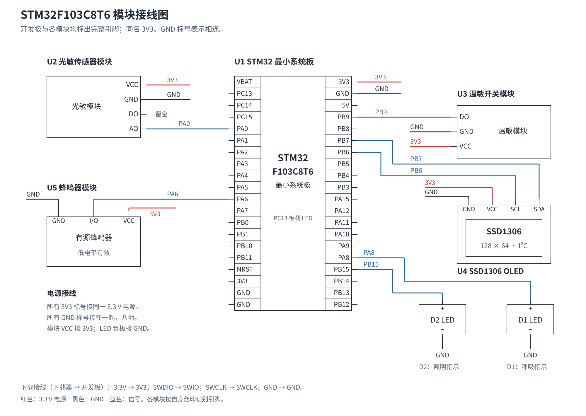

# STM32F103C8T6 温敏报警与光敏控制项目说明手册

本项目使用温敏模块检测报警状态，使用光敏模块控制照明；OLED 显示传感器输出，温敏报警时蜂鸣器鸣叫、LED 呼吸闪烁。本文按材料准备、接线、CubeMX 配置、代码编写、编译烧录和功能检查的顺序说明复现方法。

说明采用 **STM32CubeMX 和 Keil** 作为参考环境。软件版本、工具链、工程名称和目录可以按自己的习惯选择；使用仓库代码时，需要让外设配置、函数引用和编译设置相互对应。

## 1. 仓库文件说明

仓库按说明资料、硬件图纸和单片机程序分开保存。下面列出主要文件，省略库内文件和本机生成的编译输出。

```text
├── README.md                  项目说明手册
├── docs/                      说明资料
│   ├── wiring.svg             接线图预览
│   ├── prototype.jpg          实物搭建照片
│   └── manual.pdf
├── hardware/                  硬件图纸
│   └── EasyEDA/               嘉立创 EDA 专业版工程
│       ├── wiring.eprj3        工程入口
│       └── sch/                原理图集合
│           └── 接线图/        一份原理图
│               ├── 接线图.esch2   图页内容
│               └── 接线图.ecfg    原理图配置
├── firmware/                  STM32 程序工程
│   ├── source_code.ioc        CubeMX 配置入口
│   ├── .mxproject             CubeMX 辅助配置
│   ├── Core/
│   │   ├── App/               OLED 驱动与项目显示界面
│   │   │   ├── oled.c         驱动和界面实现
│   │   │   └── oled.h         函数声明
│   │   ├── Src/               初始化和应用代码
│   │   │   ├── main.c         系统时钟、初始化与启动
│   │   │   ├── freertos.c     任务、队列与控制逻辑
│   │   │   ├── adc.c          ADC 初始化
│   │   │   ├── i2c.c          I²C 初始化
│   │   │   ├── tim.c          定时器初始化
│   │   │   ├── gpio.c         GPIO 初始化
│   │   │   └── …              中断、HAL 时基等支持代码
│   │   └── Inc/               初始化代码的头文件
│   │       └── FreeRTOSConfig.h   FreeRTOS 配置
│   ├── Drivers/               HAL、CMSIS 和芯片支持库
│   ├── Middlewares/           FreeRTOS 与接口、移植层
│   └── MDK-ARM/               Keil 工程与启动配置
│       ├── source_code.uvprojx    Keil 工程入口
│       ├── startup_stm32f103xb.s  启动文件与中断向量表
│       ├── RTE/               Keil 辅助配置
│       └── EventRecorderStub.scvd
├── .gitignore                 Git 忽略规则
└── .gitattributes             Git 换行规则
```

`docs` 中的 [PDF 手册](docs/manual.pdf) 可离线阅读或打印；[SVG 接线图](docs/wiring.svg)可直接在浏览器或 GitHub 中查看。编辑接线图时，用嘉立创 EDA 专业版打开 [wiring.eprj3](hardware/EasyEDA/wiring.eprj3)，并保留同目录的 `sch` 文件夹。

`firmware` 中的 `.ioc` 用 CubeMX 打开，`.uvprojx` 用 Keil 打开，`.c/.h` 是程序源码。修改时钟、引脚和外设参数时先改 CubeMX 配置并生成代码；修改采样、报警和显示逻辑时，主要查看 `freertos.c` 和 `oled.c/h`。OLED 文件末尾设有项目专属扩展区。

编译会产生 `.hex/.bin` 固件，以及 `.axf/.o/.map` 等输出，位置由工程设置决定。复现时从源码重新构建，烧录本次生成的固件。`.gitignore` 用来忽略本机文件与编译产物；`.gitattributes` 规定 C 源码、头文件、Markdown 文档和 EDA 文件使用 LF 换行，两者均随仓库保留。

## 2. 准备材料与软件

### 2.1 材料清单

| 材料 | 数量 | 规格与用途 |
| --- | ---: | --- |
| STM32F103C8T6 最小系统板 | 1 | 带 8 MHz 外部晶振；本说明使用 HSE 作为系统时钟。 |
| I²C OLED 模块 | 1 | SSD1306 兼容，128×64，四针 VCC/GND/SCL/SDA，支持 3.3 V，默认 7 位地址 0x3C。 |
| 三针温敏开关模块 | 1 | VCC/GND/DO，带可调电位器，用于设定温敏触发阈值。 |
| 四针光敏模块 | 1 | VCC/GND/DO/AO，本项目读取 AO。 |
| 蜂鸣器模块 | 1 | 带驱动电路、支持 3.3 V 供电与控制的三针模块；采用低电平有效、可由 PWM 驱动的模块。 |
| LED 指示灯（自带限流） | 2 | 两脚，适用于 3.3 V GPIO 驱动；分别作为呼吸灯、照明灯。 |
| 面包板与杜邦线 | 按需 | 连接各模块，线头与模块插针匹配。 |
| SWD 下载器 | 1 | 例如 ST-LINK；配套 USB 线。 |
| 开发板供电 USB 线 | 1 | 使用开发板 USB 口供电时需要。 |

模块按 **3.3 V** 供电并共地，购买时确认模块规格。蜂鸣器使用带驱动电路的模块，裸蜂鸣器需要另加驱动电路。开发板若有 PC13 板载 LED，可直接用作程序运行指示灯。

### 2.2 参考软件环境

| 软件或组件 | 本工程的参考版本 | 用途 |
| --- | --- | --- |
| [STM32CubeMX](https://www.st.com/en/development-tools/stm32cubemx.html) | 6.16.1 | 配置芯片、时钟、引脚、外设和 FreeRTOS，生成工程。 |
| STM32Cube FW_F1 | V1.8.7 | CubeMX 使用的 STM32F1 HAL 和中间件包。 |
| FreeRTOS | V10.3.1，CMSIS-RTOS V2 接口 | 调度采样、控制、显示等任务；仓库已包含源码。 |
| [Keil MDK / µVision](https://www.keil.com/download/product/) | MDK 5；CubeMX 工程生成目标为 MDK-ARM V5.32 | 编辑、编译和烧录程序。 |
| ARM Compiler | 5.06 update 7，build 960 | 仓库 Keil 工程采用的编译器。 |
| [STM32F1xx_DFP](https://www.keil.arm.com/packs/stm32f1xx_dfp-keil/) | 2.4.1 | Keil 的 STM32F1 器件支持包。 |
| 下载器驱动 | 与下载器型号配套 | 让电脑和编程软件识别下载器。 |

**版本不要求完全一致。** 其他版本的 CubeMX、STM32F1 固件包和开发软件也可以复现；界面、生成文件或默认值可能有差异，配置时以本文列出的功能和参数为准。

也可以使用 ARM Compiler 6、GCC、IAR 等工具链。迁移时在 CubeMX 中生成对应工具链的工程，并使用与编译器匹配的启动文件、链接配置和 FreeRTOS 移植层。仓库现成的 Keil 工程使用 ARM Compiler 5 与 `portable/RVDS/ARM_CM3`，切换编译器时应一并调整这些配置。本文的菜单操作以 Keil 为例。工程生成方法可参考 [STM32CubeMX 用户手册](https://www.st.com/resource/en/user_manual/um1718-stm32cubemx-for-stm32-configuration-and-initialization-c-code-generation-stmicroelectronics.pdf)。

安装与准备顺序：

1. 安装 CubeMX，在软件包管理器中安装 STM32F1 固件包；使用参考环境时选择 FW_F1 V1.8.7。
2. 安装 Keil MDK，通过 Pack Installer 安装 STM32F1xx_DFP；在工程设置中选择可用且与移植层匹配的编译器。
3. 安装下载器驱动，将下载器接到电脑，确认系统能识别。
4. 下载仓库完整文件。已有初始化代码和库文件，可直接打开现成工程；从空白工程复现时继续按第 4、5 节操作。

## 3. 硬件接线

接线时先断电，按照模块上的引脚文字连接。所有模块的 GND 与开发板 GND 相连，这叫“共地”。



图中 U1～U5 表示开发板和各模块，D1、D2 表示两只自带限流的 LED 指示灯；器件名称标在图上，用途另行说明。

需要编辑接线图时，下载完整仓库，用嘉立创 EDA 专业版客户端打开 [`hardware/EasyEDA/wiring.eprj3`](hardware/EasyEDA/wiring.eprj3)。同目录的 `sch/` 保存原理图内容，需要与工程入口一起保留。工程只有一张“接线图”；查看接线关系可直接使用 SVG 接线图。

### 3.1 模块与 LED

| 模块 | 模块端 | STM32 端 | 作用 |
| --- | --- | --- | --- |
| 温敏模块 | VCC / GND | 3.3V / GND | 供电。 |
| 温敏模块 | DO | PB9 | 数字输出，只表示 0/1 状态，由模块电位器决定触发阈值。 |
| 光敏模块 | VCC / GND | 3.3V / GND | 供电。 |
| 光敏模块 | AO | PA0 | 模拟输出；程序测量这里的电压。光敏 DO 留空。 |
| OLED | VCC / GND | 3.3V / GND | 供电。 |
| OLED | SCL / SDA | PB6 / PB7 | I²C 时钟线与数据线。 |
| 蜂鸣器模块 | VCC / GND | 3.3V / GND | 供电。 |
| 蜂鸣器模块 | S、IN 或 SIG | PA6 | 控制信号；实际名称按模块丝印。 |
| 呼吸 LED | 正极 | PA8 | PA8 输出 PWM，LED 负极接 GND。 |
| 照明 LED | 正极 | PB15 | PB15 控制亮灭，LED 负极接 GND。 |

本项目使用自带限流的两脚 LED 指示灯，正极直接接 PA8 或 PB15，负极接 GND；按灯上的正负极标记接线。PC13 工作指示灯使用开发板自带 LED；没有该灯也可以完成其余功能。

PA0 的光敏输入按 **0～3.3 V** 计算，不要直接输入 5 V 信号。OLED 使用 SSD1306 兼容的四针 I²C 模块，SCL 和 SDA 要分别接到 PB6、PB7。

### 3.2 下载器和启动设置

| 下载器端 | 开发板端 |
| --- | --- |
| 3.3V | 3V3 |
| SWDIO | SWIO |
| SWCLK | SWCLK |
| GND | GND |

板子可以由自身 USB 供电。下载器上的 3.3 V 引脚可能是供电输出，也可能是电压参考输入，按具体型号使用，避免把两个供电输出直接相连。若板上有 BOOT0 跳帽，正常运行时设为 **0/LOW**，让芯片从内部 Flash 启动。

## 4. CubeMX 参数配置

可打开仓库的 [`source_code.ioc`](firmware/source_code.ioc) 对照参数，也可以新建 STM32F103C8T6 工程，从下面步骤配置。工程名称和保存位置自行选择；下文的文件路径仅用于定位仓库中的对应代码。

### 4.1 芯片、调试与时钟

1. 新建 MCU 工程，搜索 **STM32F103C8T6**，选择 LQFP48 器件。
2. 在 **System Core → SYS** 中将 Debug 设为 **Serial Wire**，保留 PA13、PA14 供 SWD 使用；将 HAL Timebase Source 设为 **TIM4**。
3. 在 **System Core → RCC** 中将 HSE 设为 **Crystal/Ceramic Resonator**，使用板载外部晶振。
4. 在 **Clock Configuration** 中按下表设置时钟树。

| 时钟项 | 参考值 |
| --- | --- |
| HSE 输入 | 8 MHz |
| SYSCLK 来源 | HSE，直接作为系统时钟 |
| PLL | 关闭，不倍频 |
| SYSCLK | 8 MHz |
| AHB 分频 / HCLK | /1，8 MHz |
| APB1 分频 / PCLK1 | /1，8 MHz |
| APB2 分频 / PCLK2 | /1，8 MHz |
| TIM1、TIM3 时钟 | 8 MHz |
| ADC 时钟 | PCLK2 /2，4 MHz |

在生成的 [`SystemClock_Config()`](firmware/Core/Src/main.c) 中，应能看到 `RCC_OSCILLATORTYPE_HSE`、`RCC_HSE_ON` 和 `RCC_SYSCLKSOURCE_HSE`，PLL 为 `RCC_PLL_NONE`。启用 FreeRTOS 后，核对 PendSV、SysTick 和 TIM4 时基中断优先级为 15。

### 4.2 GPIO、ADC 和 I²C

**先配置 ADC1，CubeMX 会分配对应引脚：**

1. 在左侧打开 **Analog → ADC1**，勾选 **IN0**。CubeMX 会自动把 **PA0** 配置成 `ADC1_IN0` 模拟输入，不需要先在引脚图中单独配置 PA0。
2. 进入 ADC1 的 **Parameter Settings**，关闭 Scan Conversion Mode、Continuous Conversion Mode 和 Discontinuous Conversion Mode；Data Alignment 选 **Right alignment**，转换由软件启动。
3. 在 Regular Conversion 中将转换数量设为 **1**，Rank 1 选 **Channel 0**，Sampling Time 设为 **7.5 cycles**。STM32F103 的 ADC 为 12 位。
4. 回到引脚图核对 PA0 已标为 `ADC1_IN0`，接线时将光敏模块 AO 接到这里。

**再配置 I2C1，核对自动分配的引脚：**

1. 在左侧打开 **Connectivity → I2C1**，将模式设为 **I2C**。
2. 在参数页选择 **Fast Mode、400 kHz、7 位地址、Duty Cycle 2**。
3. 核对引脚图中 **PB6 为 I2C1_SCL、PB7 为 I2C1_SDA**，与 OLED 接线一致；如果分配到了其他可用引脚，将其调整为这组引脚。

OLED 的设备地址由应用代码传给驱动，默认调用为 `OLED_Init(&hi2c1, 0x3CU)`；这里填写的是 **7 位地址**，驱动内部会进行 HAL 所需的地址转换。

**普通 GPIO 直接在引脚图中设置：** 点击下表引脚选择输入或输出模式，再在 **System Core → GPIO** 中调整详细参数。

| 引脚 | 模式 | 详细参数 |
| --- | --- | --- |
| PB9 | GPIO_Input | No Pull，读取温敏 DO。 |
| PB15 | GPIO_Output | Push-Pull，No Pull，Low Speed，初始输出 Low。 |
| PC13 | GPIO_Output | Open-Drain，No Pull，Low Speed，初始输出 High。 |

PA13、PA14 已由上一节 SYS 的 **Serial Wire** 设置分配为 SWDIO、SWCLK，保留该配置即可。

### 4.3 PWM 定时器

| 参数 | TIM1：呼吸灯 | TIM3：蜂鸣器 |
| --- | --- | --- |
| 输出引脚 | PA8，CH1 | PA6，CH1 |
| Clock Source | Internal Clock | Internal Clock |
| Channel 1 | PWM Generation CH1 | PWM Generation CH1 |
| PWM Mode | PWM Mode 1 | PWM Mode 1 |
| Prescaler | 7 | 7 |
| Counter Period | 9，任务启动后改为 999 | 999 |
| Pulse | 0 | 5，应用代码运行后控制占空比 |
| 输出极性 | High | Low |
| Auto Reload Preload | Enable | Enable |
| Fast Mode | Disable | Enable |

当前仓库的 `StartBreathTask` 会在启动时设置 `PSC=7`、`ARR=999`，所以 TIM1 **实际运行周期以任务设置为准**；TIM3 报警时比较值设为 500，关闭时设为 0。两路运行 PWM 频率均为：

```text
PWM 频率 = 定时器时钟 ÷ (PSC + 1) ÷ (ARR + 1)
         = 8 MHz ÷ 8 ÷ 1000
         = 1 kHz
```

若采用其他系统时钟，需要按实际定时器时钟重新计算分频值，并同步调整应用代码中的运行时设置。例如定时器时钟为 72 MHz、ARR 为 999 时，PSC 取 71 可得到 1 kHz。

### 4.4 FreeRTOS

在 **Middleware → FREERTOS** 中启用 FreeRTOS，接口选择 **CMSIS_V2**，使用 `heap_4`，FreeRTOS 堆大小 `configTOTAL_HEAP_SIZE` 设为 **8192 字节**，系统 tick 设为 **1000 Hz**。

在 Tasks and Queues 页面创建下表任务。名称为仓库代码使用的名称，直接集成源码时照此填写；自行改名时同步修改代码中的函数和句柄引用。

| 任务名 | 入口函数 | Priority | Stack Size | Allocation |
| --- | --- | --- | ---: | --- |
| SensorTask | StartSensorTask | Normal2 | 256 | Dynamic |
| ControlTask | StartControlTask | Normal3 | 256 | Dynamic |
| BreathTask | StartBreathTask | Normal2 | 128 | Dynamic |
| DisplayTask | StartDisplayTask | Normal1 | 512 | Dynamic |
| IndicatorTask | StartIndicatorTask | Normal1 | 128 | Dynamic |

这里的 Stack Size 单位为 **32 位字**，例如 256 对应 1024 字节；生成代码中的 `.stack_size` 会乘以 4。

再创建两个消息队列：

| 队列名 | 长度 | 每项类型 | Allocation |
| --- | ---: | --- | --- |
| CtrlQueue | 16 | dat_t | Dynamic |
| DispQueue | 16 | dat_t | Dynamic |

`dat_t` 是应用代码定义的数据类型，需要在编译前补入 `freertos.c`，具体见第 5 节。它让一次采样得到的温敏状态、光敏电压和开机测试标志一起传送。

### 4.5 生成工程

在 Project Manager 中选择使用的工具链。本文选择 **MDK-ARM**，STM32F1 固件包参考版本为 V1.8.7；C 库 Heap Size 为 `0x200`、Stack Size 为 `0x400`，与上面的 FreeRTOS 堆是两组不同设置。

在 Code Generator 中勾选 **Keep User Code when re-generating**，按外设生成独立的 `.c/.h` 文件，并将所需库复制到工程目录。点击 **Generate Code**，生成初始化代码及开发工具工程。

## 5. 编写与集成应用代码

CubeMX 生成引脚和外设初始化、FreeRTOS 对象及任务框架；采样、报警、显示等逻辑由应用代码完成。本仓库的应用逻辑集中在 [`freertos.c`](firmware/Core/Src/freertos.c)，OLED 驱动在 [`oled.c`](firmware/Core/App/oled.c) 和 [`oled.h`](firmware/Core/App/oled.h)。

### 5.1 将完整源码加入新工程

1. 将仓库的 `oled.c`、`oled.h` 复制到自己的工程中。源码目录可以自行安排；将 `oled.c` 加入编译列表，把 `oled.h` 所在目录加入头文件搜索路径。
2. 使用相同任务和队列设置时，可将仓库的完整 `freertos.c` 复制到生成工程的对应位置。若已自行调整任务名称或工程结构，则把各 `USER CODE BEGIN/END` 区块中的应用代码放入自己的生成文件，并同步引用名称。
3. 在 Keil 中，右键源码分组，选择 **Add Existing Files to Group** 加入 `oled.c`；通过 **Options for Target → C/C++ → Include Paths** 添加头文件目录。本仓库的参考布局对应 `..\Core\App`，其他布局填写自己的实际路径。
4. 重新生成 CubeMX 代码后，检查应用代码、OLED 源文件引用和头文件路径是否保留。使用其他工具链时，在对应工程中完成同样的源文件和头文件路径设置。

### 5.2 应用代码的编写顺序

在 `freertos.c` 的 `USER CODE BEGIN Includes` 中引入 `adc.h`、`gpio.h`、`tim.h`、`i2c.h`、`oled.h` 等需要的头文件。在 `USER CODE BEGIN PTD` 中定义数据结构：

```c
typedef struct {
    uint32_t temp;      // 温敏 DO 的 0/1 状态
    float volt;         // 光敏 AO 电压，单位 V
    uint8_t alarm_test; // 开机测试标志
} dat_t;
```

在 `USER CODE BEGIN PD` 中设置开机测试和显示间隔：

```c
#define ALARM_STARTUP_TEST_ENABLE  1U
#define ALARM_STARTUP_TEST_MS      5000U
#define DISPLAY_INTERVAL_MS       100U
```

然后在五个任务各自的 `USER CODE` 区块中编写循环。完整实现可直接查看、复制仓库的 `freertos.c`；各任务的工作顺序如下：

| 任务或函数 | 编写逻辑 |
| --- | --- |
| StartSensorTask | 读取 PB9，得到温敏 0/1；启动 ADC1，等待转换完成后读取 PA0；按 `ADC值 × 3.3 / 4095` 换算电压；把数据送入 CtrlQueue，约每 100 ms 送入 DispQueue；每轮延时约 10 ms。 |
| StartControlTask | 等待 CtrlQueue 数据；温敏为 1 或开机测试有效时，调用 Buzzer_On 并启用呼吸灯；否则关闭报警；按光敏电压控制 PB15。 |
| StartBreathTask | 设置并启动 TIM1 PWM；报警启用时用正弦变化的占空比控制 PA8；关闭时将占空比设为 0；每轮延时约 10 ms。 |
| StartDisplayTask | 初始化 OLED；等待 DispQueue 数据，取最新采样；调用 OLED_ShowSurveyScreen 更新三行显示。 |
| StartIndicatorTask | PC13 低电平 500 ms、高电平 500 ms，循环执行。 |
| Buzzer_On / Buzzer_Off | 放在文件末尾 Application 用户区；启动 TIM3 PWM，报警时设 50% 占空比，关闭时使控制端保持无效高电平。 |

控制任务中的核心判断是：

```c
if ((rx_dat.temp == 1) || rx_dat.alarm_test) {
    Buzzer_On();
    breath_enable = 1;
} else {
    Buzzer_Off();
    breath_enable = 0;
}

if (rx_dat.volt < 2.0f) {
    HAL_GPIO_WritePin(GPIOB, GPIO_PIN_15, GPIO_PIN_RESET);
} else {
    HAL_GPIO_WritePin(GPIOB, GPIO_PIN_15, GPIO_PIN_SET);
}
```

上述代码片段用于说明编写逻辑；运行工程时应使用完整文件，其中还包含 ADC 转换检查、消息队列创建、任务创建及 PWM 初始化。

### 5.3 OLED 文件与界面修改

`oled.h` 声明可调用的函数；`oled.c` 实现 I²C 发送、屏幕初始化、显存、字符绘制和刷新。显示流程是：初始化屏幕 → 清空显存 → 在显存中写文字和数值 → 将显存发送到屏幕。

两个文件末尾的**项目专属扩展区**放置本项目的中文标签、字模和三行布局。`OLED_ShowSurveyScreen` 根据测试标志和温敏状态显示 `TEST`、正常或警报，再显示温敏输出与光敏电压。换项目时可保留适用于相同屏幕的驱动部分，在扩展区调整文字和布局；新增汉字时需要补充对应字模，并同步声明。

### 5.4 调整项目参数

| 要调整的内容 | 调整位置与方式 |
| --- | --- |
| 温敏触发阈值 | 转动温敏模块电位器，观察 DO 的 0/1 变化；当前模块提供开关状态，屏幕不显示摄氏度。 |
| 温敏报警有效电平 | 当前为 PB9 高电平报警；若所用模块方向相反，同步调整控制任务和界面中的报警判断。 |
| 光控电压阈值 | 修改 `StartControlTask` 中的 `2.0f`。按本文接法，低于阈值灯灭，大于或等于阈值灯亮。 |
| 开机测试 | `ALARM_STARTUP_TEST_ENABLE` 设为 1 开启、0 关闭；时长由 `ALARM_STARTUP_TEST_MS` 决定。 |
| OLED 地址 | `StartDisplayTask` 中的 `OLED_Init(&hi2c1, 0x3CU)`。 |
| 显示文字和布局 | `oled.c/h` 末尾项目专属扩展区。 |
| 引脚和外设初始化 | 在 CubeMX 修改、保存并 Generate Code，再同步应用代码中的引脚引用。 |

修改代码后都需要重新编译、烧录。修改 `.c` 不会反向更新 `.ioc`；修改 `.ioc` 后也需要生成代码，配置才会进入源码。

## 6. 编译与烧录

以下以 Keil 和 ST-LINK 为例。使用仓库现成工程时，打开 [`source_code.uvprojx`](firmware/MDK-ARM/source_code.uvprojx)；使用自行生成的工程时，打开自己的工程文件。

1. 确认目标芯片为 STM32F103C8，编译器与 FreeRTOS 移植层相匹配；使用仓库工程时参考 ARM Compiler 5.06 update 7 和 STM32F1xx_DFP 2.4.1。
2. 在 **Options for Target → Output** 中勾选 **Create HEX File**。
3. 选择 **Project → Rebuild all target files**，等待完成，确认 **0 Error**。报错时先解决第一条错误，再重新编译。[Keil 构建说明](https://www.keil.com/support/man/docs/uv4cl/uv4cl_ca_buildproject.htm)可用于对照菜单。
4. 检查本次输出固件的时间。仓库 Keil 工程默认输出到 `MDK-ARM/source_code/`，固件名为 `source_code.hex`；自行命名或更改输出目录时，以自己的工程设置为准。
5. 接好 SWD 和电源，在 **Options for Target → Debug** 选择 ST-LINK Debugger，在 **Utilities** 页确认 Flash 编程使用相应下载器。
6. 选择 **Flash → Download**，等待下载完成；退出调试暂停或继续运行，再按开发板 RESET。[Keil Flash 菜单说明](https://www.keil.com/support/man/docs/uv4cl/uv4cl_ui_flash.htm)列出了下载入口。

使用 GCC、IAR 等工具链时，按对应工具完成构建，再通过所用下载工具写入本次生成的固件。初始化参数和下节的验收结果保持一致即可。

## 7. 上电检查、调试与验收

上电后的前约 5 秒是报警测试期：OLED 显示 `TEST`，蜂鸣器鸣叫、呼吸 LED 工作。测试结束后，温敏 DO 为 0 时显示“正常”，DO 为 1 时显示“警报”并开启报警输出。

| 操作 | 应看到或听到的结果 |
| --- | --- |
| 按 RESET | 前约 5 秒显示 TEST，蜂鸣器鸣叫、PA8 LED 呼吸；之后转入传感器控制。 |
| 观察 PC13 板载 LED | 周期闪烁，约 500 ms 亮、500 ms 灭。 |
| 遮挡、照亮光敏探头 | “光敏输出 x.xxV”改变。这里显示 PA0 接收到的光敏 AO 电压。 |
| 缓慢调温敏电位器或温热探头 | “温敏输出”在 0/1 间切换；为 1 时显示警报，蜂鸣器鸣叫、呼吸 LED 工作。 |
| 让光敏电压跨过 2.0 V | PB15 照明 LED 切换亮灭。 |

光敏模块亮暗方向应以实测为准。分别记录亮处和暗处的电压，再选两者之间的阈值，例如亮处 0.8 V、暗处 2.6 V，可先用 1.7 V。若需要在低电压时亮灯，调换控制分支中的高低电平输出。

| 现象 | 检查方法 |
| --- | --- |
| RESET 后没有启动变化 | 检查供电、BOOT0、编译和下载结果、调试是否暂停，以及 HSE 晶振与时钟配置。 |
| OLED 黑屏 | 核对 VCC/GND、PB6→SCL、PB7→SDA、屏幕驱动型号与 7 位地址；检查 I²C 接线。 |
| OLED 一直保留同一画面 | 先看 PC13 或重新 RESET 判断程序是否运行；OLED 在主控停止时可能保留上一帧。 |
| 光敏数值不变化 | 确认光敏 AO 接 PA0，供电和共地正确；确认 ADC 通道为 IN0。 |
| 温敏一直为 0 或 1 | 检查 DO→PB9，缓慢调电位器，观察模块自身指示灯；确认模块有效电平。 |
| 蜂鸣器不按报警状态工作 | 检查模块供电、GND、控制端→PA6、模块有效电平和 PWM 驱动方式；核对 TIM3_CH1。 |
| LED 不工作 | 检查正负极及 PA8/PB15 接线；呼吸灯还要核对 TIM1 PWM。 |
| 提示找不到 oled.h 或 OLED 函数 | 检查 OLED 源文件是否加入编译列表，头文件目录是否加入搜索路径。 |
| 提示 dat_t 未定义 | 在使用队列前补入数据结构定义，或检查应用代码是否复制完整。 |
| 编译器、器件包或移植层报错 | 检查实际使用的工具链及其工程配置；切换编译器时同步选择对应 FreeRTOS port。 |

